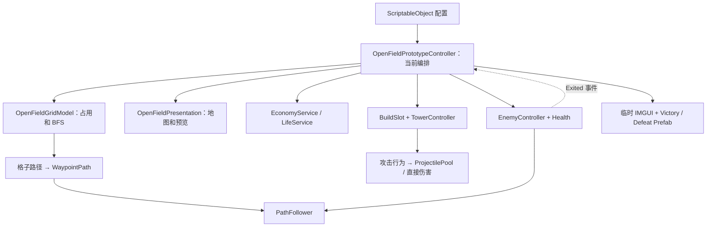

# 《胞卫战》技术架构：开放地图核心防御

2026-10-15 v0.14 更新（优先于下文历史快照）：用户已指定纤维蛋白壁垒为唯一改路塔，每关累计限建 6 座、仍花 30 ATP；普通细胞生命 100 / 容量 1，巨噬 250 / 2，敌人每秒伤害 10、Boss 25。占位 / 通行分离、承伤 / 溢出通行 / 死亡清理、路线预览与额度反馈均已接入，第一、二关增加壁垒选择。保留 15% 调速与第三关末尾真菌 Boss：倍率 0.85 / 0.6375 / 0.6375，第三关末轮 73。运行 / 测试源码静态检查通过，现有 EnemyCombatTests 共 21 项尚未执行；不运行 Unity、Play、Runner、构建或 Profiler。详见 [v0.14 接入与用户验证](LIMITED_ROUTE_DEFENSE_IMPLEMENTATION.md)。

> 架构基线：v0.8 · 2026-10-15
> 引擎：Unity 2022.3.53f1c1
> 配套：[当前策划 v0.14](GAME_DESIGN_FRAMEWORK.md) · [试玩说明](OPEN_FIELD_THREE_ROUND_PROTOTYPE.md) · [性能专题](PERFORMANCE_MANY_ENEMIES.md) · [最新交接](CHAT_HANDOFF_2026-10-13.md)

## 1. 文档边界

本文分别描述当前代码、已知限制和下一阶段的目标职责。没有对应脚本或运行证据的设计均标为待实现，不能据此声称已完成重构或性能优化。

玩法主线已转为开放地图、轮间选格建塔、三轮守核心。旧 `Prototype / Level02` 的 `GameplayCompositionRoot + GameFlowController + BuildController + WaveController + HudController` 仍服务旧场景；新场景使用独立编排，复用塔、敌人、投射物与配置。两套流程暂时并存，但同一新场景不同时运行两套流程控制器。

改版前的完整架构方案保留在 [历史快照](TECHNICAL_ARCHITECTURE_PRE_OPEN_FIELD.md)。其中的 Bootstrap、GameSession、EnemyRegistry、SignalNetwork、HomeostasisService 等目标类不能直接当作当前已有代码。

## 2. 当前代码的实际分工

2026-10-14 敌人接入补充：EnemyDefinition 新增速度 / 泄露伤害 / 防御 / 控制配置，EnemyController 提供实例抗原与统一伤害、防御、治疗和专用吞噬入口。BossPhaseController 按最低到达的生命比例排队执行阶段，独立 Fungal / Membrane / Virus 能力组件负责有限召唤和支援；EnemySpawnRequest 由关卡验证母体 / 版本 / 当前路径后注册子单位，使用 InitializeAt 保留中段进度。WaveDefinition.groups 驱动三关混合波次，旧字段保留兼容。EnemyStatusHud 每关创建一个 UGUI Canvas、按敌人实例复用血条 / 盾条并显示阶段预告。完整模块和验证见 [敌人接入](ENEMY_IMPLEMENTATION.md)，尚无 Play / Profiler 结果。

| 文件 / 模块 | 当前职责 | 不应误解为 |
|---|---|---|
| [OpenFieldPrototypeController](../Assets/_Project/Scripts/OpenField/OpenFieldPrototypeController.cs) | 组装格子模型、经济、生命和画面；处理输入、建造事务、三轮流程、出敌、敌人退出、局部信号连边、临时 UI 与结果按钮 | 已经拆分完毕的长期总管理器 |
| [OpenFieldGridModel](../Assets/_Project/Scripts/OpenField/OpenFieldGridModel.cs) | 格子占用、保留格、BFS 距离场、放置可达性检查、路径提取 | 可见 Tilemap 或运行时 NavMesh |
| [OpenFieldPresentation](../Assets/_Project/Scripts/OpenField/OpenFieldPresentation.cs) | 背景 Sprite、调试格、悬停格、塔虚影和射程圈 | 战斗规则与资源结算 |
| [OpenFieldBuildMenu](../Assets/_Project/Scripts/UI/OpenFieldBuildMenu.cs) | 运行时 UGUI 图标 / 价格选择框、可用状态、悬停回调、屏幕边缘定位与换行 | 自己扣费、提交格子占用或选择伤害策略 |
| [OpenFieldPrototypeSceneCreator](../Assets/_Project/Editor/OpenFieldPrototypeSceneCreator.cs) | 编辑器菜单创建场景、配置相机 / 池 / 资源，放入结果 Prefab 和 EventSystem，加入构建列表 | 每次运行时生成整套工程的脚本 |
| TowerController + TowerAttackBehaviour | 每轮攻击前选敌、冷却、动画释放、普通攻击与抗体 / 巨噬行为 | 塔受伤、拦截敌人或新场景流程控制 |
| EnemyController + Health + EnemyImmuneState | 生命、互斥退出、标记状态及反馈 | 直接决定玩家 ATP 或整局胜负 |
| WaypointPath + PathFollower | 接收共享路点、缓存剩余距离、沿路移动、应用场景速度倍率并报告抵达 | 自己为每个敌人做 BFS |
| Projectile + ProjectilePool | 命中结算、标记 / 采样回调、投射物复用 | 已覆盖敌人和所有特效的通用池 |
| BuildSlot | 关联塔与格子位置，为现有采样链提供一跳邻居 | 新场景必须预先摆在地图上的固定塔位 |
| EconomyService / LifeService | 保存与修改本局 ATP / 核心生命 | ScriptableObject 配置 |
| Tower / Enemy / Wave Definition | 静态数值、Prefab 与波次引用 | 本局当前生命、冷却、占用或阶段 |

GridModel 是不继承 MonoBehaviour 的规则类，但使用 Unity 的 Vector2Int 值类型；不能宣称已经完全脱离 Unity 程序集。



图中的“格子路径 → WaypointPath”转换由控制器完成；GridModel 不创建 Unity 对象。

## 3. 场景、对象与生命周期

### 3.1 当前场景入口

| 场景 | 当前作用 |
|---|---|
| OpenFieldPrototype | 主线玩法原型；主菜单开始按钮已改为进入此场景 |
| OpenFieldLevel02 | 开放地图第二关；第一关胜利面板 Next 加载此场景，复用同一控制器和战斗模块 |
| OpenFieldLevel03 | 开放地图第三关；第二关 Next 加载，左右入口、两侧短墙、六种塔及可减速 / 停顿的独立敌人 Prefab |
| MainMenu | 主菜单；StartGame 加载 OpenFieldPrototype，保留原按钮绑定 |
| Prototype / Level02 | 固定路线版本，保留验证及复用参考 |

新场景保存相机、主控制器、子弹池、Victory / Defeat 预制体实例和 EventSystem。地图显示对象、建造预览、塔位适配对象和每轮路点在运行时创建。

### 3.2 当前初始化顺序

1. 控制器 Awake 校验三轮配置、塔列表、池、相机和关键参数。
2. 创建 GridModel；初始化 ProjectilePool、EconomyService、LifeService。
3. 重置轮索引与选择塔，进入 Planning。
4. 创建并初始化 OpenFieldPresentation 与 OpenFieldBuildMenu；三场景引用已有中文 TMP 字体。选择框初始隐藏，只在点击有效空格时打开。
   同时创建本局 Enemy Pool 子节点，按首波数量预热最多 16 个敌人；各 Prefab 的闲置栈由当前控制器持有。
5. 若两套结果面板均已引用，则绑定 Again、Return；配置了有效下一场景时，胜利面板 Next 绑定 LoadNextLevel。第一关指向第二关，第二关指向第三关，第三关无下一关并隐藏 Next。
6. Start 将 Time.timeScale 设为 1。

这里的控制器同时承担“组合根”和“运行流程”。它当前确实在 Awake 组装外部对象，不能把旧目标文档中的“Awake 只缓存自身组件”写成已经遵守的事实。

### 3.3 退出与清理

- EnemyController 在 OnEnable 订阅自身 Health / PathFollower，OnDisable 取消订阅。
- 控制器订阅每个入场敌人的 Exited；正常结算时移出 activeEnemies、取消订阅并 ReturnEnemy。每种 Prefab 最多保留 128 个闲置实例，超过时销毁。这是闲置上限，不是活跃或总创建上限。
- FinishRun 停止生成协程，解除剩余敌人的外部退出订阅并直接回收敌人，清空活跃集合、销毁路点、隐藏预览、显示结果。敌人池随单场景卸载销毁。
- EnemyController.Initialize 每次入场递增 SpawnVersion。塔的锁定目标、动画待释放目标和子弹目标都记录版本，防止旧引用命中新一轮复用的实例。
- 重开与返回使用 SceneManager 单场景加载，并恢复 timeScale；重开时重新创建本局状态。
- Presentation.OnDestroy 释放自行创建的 Sprite 与射程 Material。
- 控制器 OnDisable 清空建造选择、关闭选择框和预览；开战 / 终局也会清理选择。本轮清场没有集中释放所有在飞投射物，仍未建立覆盖所有运行对象的统一退出清理。

## 4. 地图与寻路实现

### 4.1 数据结构

GridModel 保存 bool[,] occupied、bool[,] blocked、int[,] distances、核心格及复制后的入口数组。核心和入口是保留格；入口必须在地图内、不重复且不等于核心。第二关从场景序列化固定障碍，初始化时检查障碍合法且两个入口均可到达核心。

CalculateDistances 从核心开始做四邻接 BFS：核心距离为 0，障碍和不可达格保持 -1。单位格子代价相同时，距离值表示最少需要经过的格数。

TryGetPath 从入口开始，每次选择距离值减 1 的邻格，直到核心。当前邻居顺序固定为上、右、下、左，因此同等长度路线使用确定的取路顺序。

### 4.2 放塔不能封路

CheckPlacement 先检查越界、保留格、固定障碍和已占格，再临时占用候选格，计算候选距离场，并在 finally 中恢复占用。只要任一入口距离小于 0，返回 BlocksRoute。

TryOccupy 再次验证并正式提交占用，重算实际距离场。Release 用于释放占用并重算，目前主要用于异常回滚；存在 Release 方法不代表新场景已经开放出售。

### 4.3 与原移动系统衔接

开战时控制器为每个入口提取一条格子路径，转为格子中心的 Transform 路点，再调用 WaypointPath.Configure。敌人初始化时取得对应 WaypointPath，继续使用原 PathFollower。

WaypointPath 为每个路点缓存到终点的剩余世界距离；Configure 重建缓存。PathFollower.RemainingDistance 用当前位置到下一点的距离加该点的缓存值，供多入口锁敌比较。运行中移动路点后必须重新配置，当前进攻期路径保持静止。第二关的 enemySpeedMultiplier 为 0.75，每次入场设置到 PathFollower，避免池复用后遗漏场景调速。

这是“距离场生成共享路点路径”的实现。当前没有让所有敌人逐帧直接采样距离场，也没有每敌人 A*、物理避障、拥挤处理、敌人互相阻挡或拆塔规则。进攻阶段禁止修改地图，使当轮路径保持稳定。

### 4.4 复杂度与实际开销

一次 BFS 的时间和辅助空间为 O(宽 × 高)；一次路径提取与路径长度相关。每次成功建塔后重建信号邻接使用 O(塔数²) 的两两距离检查。

空格悬停结果缓存到鼠标移入另一格或建造改变占用；选塔悬停锁定已通过可达检查的格子，不逐按钮执行 BFS。点击打开选择框和最终提交仍调用 CheckPlacement，每次分配候选距离数组与 Queue。建造还会重复验证和重算；不能声称所有 BFS 只在建塔成功时执行，也没有 Profiler 性能数据。

优先改进候选格和地图占用版本的缓存，仅在输入相关条件改变时更新预览；再依据 Profiler 决定是否复用数组 / 队列或减少提交重算。当前尚无优化前后性能数据。

## 5. 关键业务链路

### 5.1 建造事务

```text
鼠标屏幕坐标 → 相机世界坐标 → 逻辑格坐标
→ Planning / 塔配置 / 格子可达性 / ATP 检查
→ EconomyService.TrySpend
→ 创建 BuildSlot 与塔实例
→ TowerController.Initialize → BuildSlot.Occupy
→ GridModel.TryOccupy → 记录 placedSlots → 重建信号邻接
```

发生异常时，当前实现会归还 ATP、销毁已创建对象；若占用已提交，还会 Release 并移除字典记录。下一阶段拆分仍须保证失败不留资金、占用或塔对象残留。未来若给邻接更新增加会失败的步骤，还应检查其是否需要整体重建以完成回滚。

旧 BuildController 对 TowerSite / RoadSite 的匹配规则没有参与新场景的建造；新场景通过临时 BuildSlot 复用塔的占用引用和信号接口。

### 5.2 出敌与三轮状态

```text
StartAssault：仅允许 Planning
→ 为各入口创建本轮路径
→ allEnemiesSpawned = false，Phase = Assault
→ 启动 SpawnRound 协程
→ 复用敌人池实例，Initialize 后设置当前场景速度倍率
→ 第 i 个敌人选择 i % 入口数 的路径
→ 组内使用 SpawnInterval，组尾到下一组使用 BurstInterval
→ 生成完毕后 allEnemiesSpawned = true
→ 同时满足 activeEnemies 为空才完成本轮
```

当前硬性校验 WaveCount == 3，界面也显示 /3。WaveSequenceDefinition 的 interWaveDelay 在新控制器中未使用：前两轮结束后自动回到 Planning，但下一轮仍需玩家手动开始。

WaveDefinition 增加 BurstSize / BurstInterval；BurstSize 为 1（包括旧资产缺字段）时保持原逐个生成间隔。旧 WaveController 不使用分组字段。SpawnRound 每轮复用两份 WaitForSeconds，不再为每个敌人新建等待对象。

### 5.3 敌人退出与终局

EnemyController.TryExit 用 hasResolved 保证单个敌人只退出一次；控制器通过 HashSet.Remove 的结果拒绝再次结算。

Killed 发放配置中的 ATP，Leaked 扣 1 核心生命，Cleared 不发奖励也不扣生命。控制器先检查核心归零，再检查本轮完成，因此最后一只敌人泄露导致归零时进入 Defeat。

当前终局清理采用“取消外部订阅后直接回收剩余敌人”；它不通过每个敌人的 Clear 方法统一退出。后续整合清理入口时应明确 Cleared 的业务含义并保持无奖励。已配置核心攻击动画的敌人在抵达时停止移动，动画事件 CompleteCoreAttack 或 0.6 秒超时触发一次 Leaked 结算；该动作阶段 CanBeTargeted 为 false。

### 5.4 局部信号与特殊攻击

近卫塔命中回调读取 AntigenId，经 occupiedSlot.ShareAntigen 把样本交给一跳邻居中的 AntibodyAttackBehaviour。新场景按格坐标半径自动配邻居；由于两两都检查，距离关系是对称的，但实际传递仍由采样塔的命中触发。

B 塔仅在认识目标抗原时发射纯标记子弹，InitializeMark 不造成伤害。EnemyImmuneState 记录标记结束时间，EnemyController.TakeDamage 在结算时统一应用一次 15% 易伤；重复标记不叠加倍率，回池和 Initialize 清除。巨噬行为按剩余生命与标记选择普通伤害或吞噬。第三关追加减速光环、固定酸区与神经连锁，见对应接线文档。

### 5.4.1 前排选敌与动画出手

现有三塔的 TargetingMode 均为 FarthestAlongPath，保留序列化数值 1，但指标改为剩余实际路径距离最短。每轮攻击开始前重新查询射程内敌人；前排距离并列时才使用 TowerAttackBehaviour.GetTargetPriority，最终按到塔距离破同分。NearestToTower 仍作为可配置模式保留。

FindTarget 用 Physics2D.OverlapCircle 的 List 重载复用 targetCandidates（初始容量 64），保留敌人中心精确距离过滤。候选超过容量时允许扩容，因此不能写成任何情况下都零分配。查询的 Marker 为 CellDefense.Targeting.Query。

默认攻击从场景 ProjectilePool 取子弹；挂一个 TowerAttackBehaviour 时由策略执行一次攻击。CurrentDamage 已包含升级加成。近卫 Prefab 启用 releaseOnAnimationEvent：记录目标与版本、触发 Attack，动画事件 ReleaseAttack 才发射，超过 0.6 秒未释放则取消。准备期间死亡或回池复用会取消出手；当前 ReleaseAttack 不再检查射程，也不会在该事件里临时换目标。

新增塔的阅读与接入步骤见 [源码课程 T01](tutorial.md)。当前每座塔最多一个攻击策略组件；samplesAntigenOnHit 与特殊策略不能同时启用。ProjectilePool 使用其 Inspector 固定 Prefab，TowerDefinition.ProjectilePrefab 不负责自动切换子弹池。选择框按场景 towerDefinitions 创建选项，第一、二关三项，第三关六项；数字键只在选择空格后建造。

当前 BuildSlot 运行时只添加了自身组件，没有自动添加 AntigenSignalFeedback，因此逻辑邻接存在不等于信号连线已经可见。

### 5.5 结果 UI 与输入

结果面板以场景引用传给控制器，Awake 用固定子路径查找按钮并绑定；FinishRun 根据 Phase 控制显示。结果面板可用时，OnGUI 在终局直接返回，避免同时显示两套结果操作。

布置输入排除临时 IMGUI 工具栏、选择框实际矩形及 EventSystem 遮挡，避免 EventSystem 更新顺序使点击选项穿透地图。selectedBuildCell 是固定建造位置，hoveredBuildIndex 只控制该位置的预览。点击选择后调用既有 TryBuildAt 扣费、初始化与占用事务；成功关闭，失败保留选择且按原规则退费。右键、Esc、取消、开战、终局和禁用均关闭选择。结果按钮仍按固定子路径查找，后续可改为独立 UI 引用。

## 6. 配置与运行时状态的边界

| 当前配置来源 | 内容 |
|---|---|
| 场景中的控制器 Inspector | 地图尺寸、格大小、核心 / 入口、固定障碍、初始与轮间 ATP、生命、敌人速度倍率、信号半径、资源和 UI 引用 |
| TowerDefinition 资产 | Prefab、图标、价格、射程、伤害、间隔、锁敌模式 |
| EnemyDefinition 资产 | Prefab、最大生命、击杀奖励、抗原和吞噬相关属性 |
| WaveDefinition / WaveSequenceDefinition | 单轮敌人配置、数量、组内 / 组间间隔、组大小和轮序列 |
| 塔 / 敌人 Prefab 组件 | 标记时间、吞噬 / 消化参数、视觉组件、移动速度等 |

当前 ATP、当前生命、阶段、敌人集合、格子占用、冷却和抗原记忆均属于运行时状态，不能写回共享 SO。

第一关目前复用原三波资产；第二关使用独立的 OpenField02_WaveSequence 与三个 WaveDefinition。下一阶段可建立独立的 OpenFieldLevelDefinition（暂定名，尚无此文件），归集地图、静态障碍、入口和初始资源，并让第一关波次也独立，避免调新玩法数值时影响旧关卡。首版不必同时做通用配置编辑器。

## 7. 下一阶段目标职责（均待实现）

| 拟拆出的组件 / 规则 | 负责什么 | 为什么现在值得拆 |
|---|---|---|
| OpenFieldInputController | 选塔、指针转格、UI 遮挡、取消和开战意图 | 正式 UGUI 与将来的触控需要共同的命令入口 |
| OpenFieldBuildService | 建造检查、扣费 / 退款、生成与占用、通知邻接更新 | 保留建造事务边界，避免输入层直接扣钱 |
| OpenFieldRoundController | Planning / Assault / Victory / Defeat、轮间奖励、终局优先级 | 能独立解释和验证状态转换 |
| OpenFieldEnemySpawner | 单轮生成协程、入口分配、停止生成 | 混合波次或入口配置变化不应修改 UI |
| OpenFieldHud / ResultUI | 订阅状态，显示资源、面板，转发按钮意图 | 移除总控制器里的 IMGUI 和按名称找按钮 |
| 轻量组合根 | 创建本局对象、传引用、统一 Dispose / 清理 | 明确谁创建谁销毁，总控制器不继续增长 |

这些是目标职责名，可随真实代码边界调整；不要求每项都引入接口或继承层。GridModel 与现有战斗模块优先保留，通过 Initialize、构造参数或 Inspector 显式传引用。

建议顺序为：结果 UI / HUD 与输入拆分 → 建造事务 → 回合和出敌 → 统一清理与独立配置。每一步保持同一个场景可运行；完成后再决定是否改名或统一新旧入口。不要在同一场景并挂新旧 WaveController 处理同一批敌人。

## 8. Unity 学习与技术引入条件

| 技术 | 当前状态 / 引入条件 | 应形成的证据 |
|---|---|---|
| UGUI、Prefab、序列化 | 已用；下一步独立 UI 组件、事件与 Inspector 引用 | 按钮绑定、缩放、UI 点击不穿透 |
| BFS / 距离场 | 已实现开放格子规则，待独立理解和修改 | 能解释临时占用、入口可达性和共享路径 |
| 状态与 C# 事件 | 目前枚举 + 条件判断，敌人退出为事件 | 合法转换、双条件清场、失败优先、取消订阅 |
| ScriptableObject | 已有塔、敌人、波次配置 | 配置与当前状态分离，新旧关卡配置不串改 |
| 对象池 | 投射物与开放场景敌人已池化；旧 WaveController 仍直接生成和销毁 | 重置、事件取消、SpawnVersion、闲置上限和活跃上限的区别 |
| Profiler / Memory Profiler | 根据预览检查、索敌和生成的实际开销安排测量 | 相同规模和设备的前后对比，无虚构收益 |
| Tilemap / 编辑器工具 | 需要可编辑固定障碍或重复地图制作时引入 | 可见地形与逻辑占用一致，入口始终可达 |
| Input System | 需要触控、手柄或重映射时引入 | 相同命令接口支持不同输入方式 |
| Jobs / Burst / ECS | 大量实体造成可测瓶颈且数据整理有收益时做隔离实验 | 与当前实现比较 CPU、GC、内存和改造成本 |
| Addressables / 引擎升级 | 有加载、资源管理或版本迁移学习目标时另开实验 | 依赖、加载卸载与兼容性证据 |

目前没有使用 ECS，也不能把“引入 ECS”直接等同于减少内存。先定位耗时或分配来源，再选择技术；三轮玩法本身已经提供图算法、状态约束、配置管理、事务与生命周期的学习材料。

核心手写任务沿用当前学习约定：先说明变量名、类型、用途、读写和重置时机，再由开发者写或独立改核心逻辑；普通样板可由 AI 实现。Notion 记录项目事实与决策，不记录个人作答和评分。

## 9. 具体技术债与验证风险

1. **总控制器过重**：输入、生成、规则和 UI 混合；按第 7 节逐步拆。
2. **预览重复 BFS 与分配**：当前每帧候选检查，需缓存与 Profiler 证据。
3. **动画释放约束**：事件等待上限固定 0.6 秒、释放时无二次射程检查；新增慢前摇塔需要先决定目标承诺和超时规则。最新前排锁敌已实现，尚待完整 Play 回归。
4. **结束清理分散**：敌人已经回池，仍需统一幂等清理和集中处理活跃投射物，不能把加入池当作完整的生命周期治理。
5. **地图图片不参与逻辑**：画上的障碍、塔的碰撞体和占用数组不是同一数据来源。未来需要障碍定义与地图对齐工具。
6. **旧数据共享**：新原型仍用旧波次资产；分离关卡配置后再扩内容。
7. **表现与交互仍有缺口**：临时 HUD、缺路线 / 信号可视化、无新场景暂停入口；主菜单入口已切到新场景，完整循环仍待 Play 验证。
8. **性能仍待测量**：目标查询已复用 List、路径距离已缓存，列表扩容、预览 BFS、IMGUI 字符串及表现开销仍需 Profiler 定位；没有稳态零 GC 或帧率提升数据。
9. **菜单和新塔接入**：当前仅显示前三种塔；特殊策略、采样开关与固定子弹池模板容易产生错误组合。
10. **IDE 诊断不同步**：用户报告 CS1061（SpawnVersion 不存在），磁盘中实际已定义且 csproj 包含正确文件；优先刷新语言服务和检查 F12 跳转，刷新后的红线结果待确认。

上述为当前代码审查结论及待测风险。本文记录已落盘的密集生成、池化、前排选敌和动画事件，不宣称它们已有性能收益或全部完成运行验收。

## 10. 验证边界与下一次重构验收

本次交接只核对代码并更新文档、扩展接口注释，没有运行 Play、构建或 Profiler。用户反馈塔动画感觉跑通；工作区既有动画反馈报告早于最新选敌代码，不能证明最新前排优先、多入口切换、完整三轮与所有按钮已经验收。报告范围见 Docs/Art/AnimationIntegration/2026-10-12/gameplay/level-validation.json。

重构时重点守住：

- 占用一个格后所有入口仍可达；查询候选格不改变正式占用。
- 失败建造的资金、塔对象和格子记录保持一致。
- 一个敌人只奖励或扣血一次，清理不发奖励。
- 出完且清空才结束本轮；核心归零始终失败优先。
- 状态变更、UI 点击、场景重开和退出不重复回调。
- 地图表现、引用和旧场景共享的战斗行为不因拆分丢失。

纯格子规则、资金回滚和终局优先级适合在改动它们时增加少量有意义的测试；普通文档 / 接线改动不默认扩展测试体系。Profiler 采样应记录设备、版本、地图、塔 / 敌人数、操作和测量结果。

## 11. 架构决策记录

| 编号 | 决策 | 原因与边界 |
|---|---|---|
| OF-01 | 开放地图规则使用格子占用和从核心出发的 BFS | 当前为等代价格、多入口、共同终点；不需要每个敌人独立搜索 |
| OF-02 | 每轮生成共享 WaypointPath | 保留既有 PathFollower，降低玩法改版成本 |
| OF-03 | 只在布置期修改占用 | 进攻路径稳定，暂不处理运行中被堵和拆塔 |
| OF-04 | BuildSlot 作为战斗信号适配对象 | 复用近卫采样与 B 塔记忆，同时改为距离邻接 |
| OF-05 | 当前原型控制器集中编排，下一步渐进拆分 | 玩法已经得到认可，正式 UI 和内容扩展开始产生独立变化点 |
| OF-06 | 保留旧场景，但新场景只保留一套流程编排 | 支持回归和对照，防止重复生成 / 结算 |
| OF-07 | 投射物复用现有池，开放场景敌人加入按 Prefab 的闲置池 | 密集波次减少重复创建，闲置上限不等于活跃上限；性能效果待测 |
| OF-08 | 原 Prefab 复用于胜败 UI，后续独立 UI 组件持有引用 | 保留美术成果，降低总控制器与层级名称的耦合 |

2026-10-03：以实际开放地图代码替换旧目标架构作为正文，保留历史快照；新增当前 / 目标职责对照、BFS 实际调用边界、共享数据风险、跨路线锁敌风险与求职学习路径。

2026-10-13：按当前源码更新敌人池、分组波次、速度倍率、剩余距离锁敌、动画释放与新塔扩展边界；塔生命和拆塔讨论没有改变现有格子通行规则。
